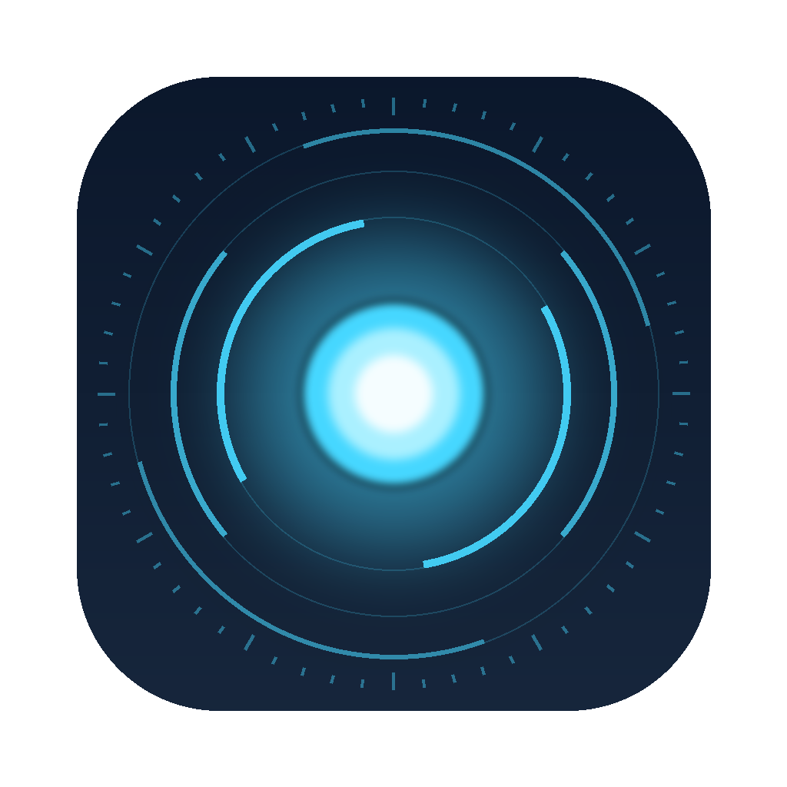

<p align="center">
  
</p>

<h1 align="center">TESS</h1>

<p align="center">
  <b>A JARVIS-style voice assistant for macOS.</b><br>
  Say “Hey Tess” — she listens on-device, thinks with Claude, OpenAI or a local Ollama model, acts on your Mac, and answers out loud.
</p>

<p align="center">
  <a href="https://github.com/juanknowit/TESS/actions/workflows/build.yml"></a>
  
  
  <a href="LICENSE"></a>
</p>

---

TESS lives in your menu bar, listens for **“Hey Tess”**, thinks with the AI of your choice (Claude, OpenAI, or a local Ollama model), acts on your Mac, and answers out loud. A glowing HUD orb appears at the top of the screen while she listens, thinks and speaks.

## Features

- **Hands-free** — on-device “Hey Tess” wake word, follow-up questions without repeating it, interrupt her mid-sentence
- **Your choice of brain** — Claude (with built-in web search), OpenAI, or a private local model through Ollama
- **Natural voice** — macOS Premium voices or OpenAI's text-to-speech
- **Mac control** — apps, volume, dark mode, screen lock, file search, screenshots, timers
- **Your day** — calendar, reminders, weather, local news for your city, and a spoken morning briefing
- **Sees and reads** — “What am I looking at?”, summarise PDFs and Word documents
- **Writes for you** — types into any app, sends Messages (always reads them back first), manages Apple Notes
- **Remembers** — long-term memory you can view and edit
- **Settings** — dark sidebar settings with usage statistics and one-click permission setup

## Install

### Download a build

Every tagged release has a ready-made `TESS.zip` on the [Releases](https://github.com/juanknowit/TESS/releases) page. TESS isn't notarised, so the first time, right-click the app › **Open**, or run `xattr -dr com.apple.quarantine /Applications/TESS.app`.

### Build from source

Requirements: macOS 14 Sonoma or later, plus Xcode or just the Command Line Tools (`xcode-select --install`).

```bash
git clone https://github.com/juanknowit/TESS.git
cd TESS
./build.sh --install     # builds, copies to /Applications and launches
```

`./build.sh` alone just builds `build.noindex/TESS.app`.

## First run

1. **Allow the microphone and speech recognition** when macOS asks.
2. **Turn on Dictation** (System Settings › Keyboard › Dictation). This downloads the on-device speech model TESS uses, so your voice is transcribed locally.
3. The Settings window opens. Under **Brain**, choose a provider:
   - **Claude** — paste an API key from console.anthropic.com. Built-in web search is on by default.
   - **OpenAI** — paste a key from platform.openai.com.
   - **Ollama** — install from ollama.com, run `ollama pull llama3.1`, no key needed.
   Press **Test connection**.
4. Under **General**, set your name and home city (for weather).
5. Say “Hey Tess, what’s the weather tomorrow?”

## Things to say

| Area | Examples |
|---|---|
| Mac | “Open Safari” · “Quit Notes” · “Volume to 30” · “Mute” · “Dark mode” · “Lock the screen” · “Take a screenshot” · “Find my tax return PDF” · “How’s my battery?” |
| Timers | “Set a ten minute timer for the pasta” |
| Live info | “What’s the weather in Paris this weekend?” · “Any news about Formula 1?” · “Who won the match last night?” |
| Calendar | “What’s on my calendar today?” · “Add lunch with Maria tomorrow at one” |
| Reminders | “Remind me to call the bank Friday at 9” · “What are my reminders?” · “Mark ‘buy milk’ done” |
| Music | “Play some Daft Punk” · “Pause” · “Next track” · “What’s playing?” |
| Briefing | “Good morning” · “Brief me” — or automatically the first time you unlock your Mac each morning |
| Screen | “What am I looking at?” · “What does this error mean?” · “Summarise this page” |
| Documents | “Summarise the PDF I just downloaded” · “What's the total on this invoice?” · “Read me the open document” |
| Typing | “Write a reply saying I'll be ten minutes late” — typed wherever your cursor is |
| Messages | “Text Maria I'm running late” — TESS reads it back and only sends after you say yes |
| Notes | “Make a note: call the plumber Monday” · “Add oat milk to my shopping list note” · “What's in my packing note?” |
| Memory | “Remember that I take my coffee black” · “What do you remember about me?” · “Forget my coffee order” |
| Conversation | Ask anything. After she answers, just keep talking — no wake word needed for a few seconds. Say “stop” or “that’s all” to end, or “Hey Tess” to interrupt her mid-sentence. |

You can also click the menu bar icon to type a request or press **Talk now**.

## Settings, memory and usage

Click the menu bar icon › **Settings…**. The window has a searchable sidebar:

- **General** — your name, home city, wake word, follow-ups, personality, music app, launch at login.
- **Brain** — choose Claude, OpenAI or Ollama, set keys and models, test the connection. Ollama shows whether it's running and which models are installed.
- **Voice** — macOS voice or OpenAI voice (Marin and Cedar sound most natural).
- **Memory** — long-term facts TESS remembers about you. Say “Hey Tess, remember that…”, or add them by hand. Delete any memory, or turn memory off entirely.
- **Usage** — tokens per provider, requests, commands, tools used, a daily trend chart, and TESS's live memory use.
- **Permissions** and **About**.

Usage statistics and memories are stored only on your Mac in `~/Library/Application Support/TESS`.

## Voices

- **macOS voice** (default): free and offline. For a much more natural sound, download a *Premium* voice in System Settings › Accessibility › Spoken Content › System Voice › Manage Voices, then pick it in TESS › Voice.
- **OpenAI voice**: very natural; uses your OpenAI key (works even if Claude or Ollama is the brain).

## Permissions TESS may ask for

| Permission | Why |
|---|---|
| Microphone, Speech Recognition | Wake word and commands |
| Calendars, Reminders | Reading and adding events/reminders (asked on first use) |
| Automation | Controlling Music, Spotify, System Events (asked on first use) |
| Accessibility (optional) | A true screen lock; without it TESS sleeps the display instead |

If you rebuild without an Apple Development certificate, macOS may ask again because the app’s signature changes. With Xcode signed in to an Apple ID, `build.sh` picks up your development certificate automatically.

## Privacy

Speech is transcribed on-device. Only the text of your request (and tool results such as weather data, screenshots or document text when you ask for them) is sent to the AI provider you chose — or nowhere at all with Ollama. API keys are stored in your login keychain; usage statistics and memories stay in `~/Library/Application Support/TESS`. See [SECURITY.md](SECURITY.md).

## Project layout

```
Sources/TESS/
  TESSApp.swift          menu bar app entry point
  Assistant.swift        orchestrates listen → think → speak, morning briefing
  Settings.swift         preferences, system prompt, provider factory
  Memory.swift           long-term memory store and tools
  Stats.swift            usage statistics
  Permissions.swift      checking and requesting macOS permissions
  Audio/VoiceListener    microphone, on-device speech recognition, wake word
  Audio/VoiceSpeaker     macOS / OpenAI text-to-speech
  AI/                    Claude, OpenAI/Ollama providers and the tool-calling agent loop
  Tools/                 Mac control, info & news, calendar, music, screen, documents,
                         typing, Messages & Notes, briefing
  UI/                    HUD orb, menu bar panel, theme, settings window
```

Adding a skill is one `Tool(...)` in a file under `Tools/`, registered in `ToolRegistry.standard`. See [CONTRIBUTING.md](CONTRIBUTING.md).

## Troubleshooting

- **She never hears “Hey Tess”** — check Dictation is on, and the right language is chosen in Settings › General. Try the menu bar’s *Talk now* to confirm the mic works.
- **“Rejected the API key”** — re-paste the key in Settings › Brain and press Test connection.
- **“I can’t reach Ollama”** — open the Ollama app or run `ollama serve`.
- **Spotify search doesn’t auto-play** — Spotify only allows that through its own Web API; TESS opens the search for you. Play/pause/skip work fully.

## License

[MIT](LICENSE) © 2026 Juan Gonzalez
